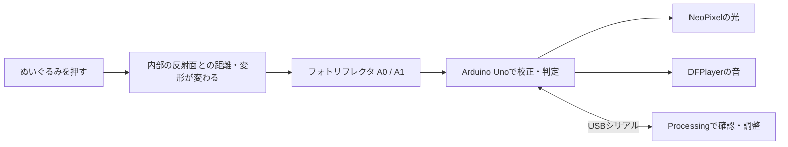

# NUIGURUMI — やさしく、ふれる。

**ぬいぐるみを押す加減を、光と音で伝えるArduino Unoの試作プロジェクトです。**

ぬいぐるみ内部の2つのフォトリフレクタで変形を読み取り、緑・黄・赤の光と音でフィードバックします。幼児が大人と一緒に「そっと触れる」「少し弱める」を試せる体験を目指しています。Processingの画面でセンサー値を見ながら、押し基準の調整と保存ができます。

> フォトリフレクタが読むのは反射光です。表示する「押し加減」は校正した変形の目安で、力［N］の測定値ではありません。学習効果は未検証の開発中の試作です。

[はじめ方](#はじめ方) · [配線](#配線) · [初回の校正](#初回の校正processingで操作) · [音の設定](#音の設定) · [困ったとき](#困ったとき) · [検証記録](docs/validation.md)

## できること

- A0・A1の2か所を個別に校正し、反応の大きい側に合わせて光を変える。
- 読み取り値の平滑化、境界の揺れ対策、約120msの継続確認で反応を安定させる。
- **標準設定では、押し始めにSDカード内の既存音を1回再生する。** 押し続けても連打せず、離して押し直すと再生する。
- 校正の変化幅をArduinoのEEPROMに保存する。次回起動時は無負荷値を読み直す。
- Processingで接続先の選択、2センサーのグラフ、状態表示、校正・保存・消音を操作する。
- 実機をつながず、Processingのデモ画面を試す。



## 必要なもの

| 種類 | 内容 |
| --- | --- |
| マイコン | Arduino Uno（AVR、ATmega328P） |
| センサー | アナログ出力のフォトリフレクタ ×2 |
| 光 | NeoPixel互換LED ×5 |
| 音 | DFPlayer Mini、対応するmicroSD、スピーカー、使用できる音源 |
| その他 | ぬいぐるみ、反射面・固定材、配線、適切な電源、USBデータケーブル |
| PCソフト | [Arduino IDE](https://www.arduino.cc/en/software/) と [Processing 4](https://processing.org/download/) |
| Arduinoライブラリ | Adafruit NeoPixel、DFRobotDFPlayerMini |

センサーの型番・抵抗値は確定していません。手元の部品の仕様を確認してください。**AOなどのアナログ出力が必要**で、DOのみの出力はこのコードの連続値判定に使えません。現在の実機では、押す／反射面を近づけるとADC値が減ります。

## 配線

**電源を切ってから配線します。** 信号線は次の割り当てです。

| 部品側 | Arduino Uno側 | 補足 |
| --- | --- | --- |
| センサー0のアナログ出力 | **A0** | センサーの電源・抵抗は部品仕様に従う |
| センサー1のアナログ出力 | **A1** | 同上 |
| NeoPixelの **DIN** | **D3** | DOUTではなく入力側につなぐ |
| NeoPixelの5V / V+ | 規定の5V電源 | I/Oピンから給電しない |
| NeoPixelのGND | GND | Arduino・各モジュールと共通にする |
| DFPlayerのTX | **D10** | Arduino側の受信 |
| DFPlayerのRX | **D11 → 1kΩ抵抗 → RX** | Arduino側の送信 |
| DFPlayerのVCC / GND | 部品仕様に合う電源 / 共通GND | 再生時の電流も考慮する |
| スピーカー | DFPlayerの **SPK1・SPK2間** | Unoのピンへ直接つながない |

NeoPixelの入力抵抗・電源コンデンサは[Adafruitの接続資料](https://learn.adafruit.com/adafruit-neopixel-uberguide/best-practices)、DFPlayerの電源・対応SDカードは[DFRobotの資料](https://wiki.dfrobot.com/dfr0299)を確認してください。

ぬいぐるみの内部では、センサーの向きと反射面を固定し、押すとその距離が変わる構造にします。綿に埋めるだけでは反射量が安定しない場合があります。基板や配線を絶縁・固定し、硬い部品が押す手に当たらず、子どもが小部品や電池に触れられない構造にしてください。まず大人だけで明るさ・音量・反応を確認します。

## はじめ方

### 1. ダウンロードする

Gitを使う場合：

```sh
git clone https://github.com/25im0047-commits/nuigurumi.git
cd nuigurumi
```

Gitを使わない場合は、GitHubの **Code → Download ZIP** で取得します。展開したフォルダー名を **`nuigurumi`** に変更してください。Arduinoでは、フォルダー名と `nuigurumi.ino` の名前をそろえる必要があります。

### 2. Arduinoに書き込む

1. Arduino IDEで、ルートにある **`nuigurumi.ino`** を開く。`NuigurumiConfig.h` と `PressureModel.h` も同じフォルダーに置いたままにする。
2. ボードマネージャーで **Arduino AVR Boards** を用意し、ボードを **Arduino Uno** にする。
3. ライブラリマネージャーで **Adafruit NeoPixel** と **DFRobotDFPlayerMini** をインストールする。`SoftwareSerial` と `EEPROM` はUnoのコアに含まれる。
4. USBでUnoをつなぎ、その接続ポートを選ぶ。
5. **アップロード（→）** を押す。Processingを使っていた場合は、先にそちらを切断する。
6. 書き込み後はセンサーから手を離す。起動時に無負荷値を約1秒採取する。音声モジュールの初期化を含め、数秒待つ。

### 3. Processingの画面を開く

1. Processing 4を起動し、[processing/nuigurumi_monitor/nuigurumi_monitor.pde](processing/nuigurumi_monitor/nuigurumi_monitor.pde) を開く。Javaモードで実行する。
2. **実行（▶）** を押す。標準のSerialライブラリを使う。
3. まず画面だけ確認したい場合は **「デモで試す」** を押す。デモでは実機への命令を送らない。
4. 実機で使う場合はデモを終了し、**Arduino IDEのシリアルモニター／プロッターを閉じる**。
5. **「接続先を切り替え」** でUnoのポートを選び、**「接続する」** を押す。macOSでは `cu.usbmodem…`、Windowsでは `COM…` など、環境によって名前が異なる。
6. センサーから手を離して約4秒待つ。接続時にUnoが再起動する場合がある。

> 同じUSBポートは、ProcessingとArduino IDEのシリアル画面で同時に開かないでください。書き込み前はProcessingを切断し、画面で使う時はArduino側のシリアル画面を閉じます。

## 初回の校正：Processingで操作

校正は、**押していない時の値**と、**大人が決めた押し基準**を記録する操作です。ぬいぐるみに組み込んだ状態で行ってください。センサーがむき出しの状態で作った基準は、組み込み後に取り直します。

| 順番 | 操作 | センサーの状態 |
| --- | --- | --- |
| ① | **「無負荷を測る」** | 両方から手を離し、約1秒動かさない |
| ② | **「A0の押し基準を測る」** | A0側を基準の押し加減で押し、約1秒保つ |
| ③ | **「A1の押し基準を測る」** | A1側を同様に押し、約1秒保つ |
| ④ | **「校正を保存」** | 両方から手を離し、保存完了を確認する |

**②③は「先に押す → 押し加減を安定させる → ボタンを押す → 完了まで保つ → 離す」の順です。** ボタンを押した直後から採取するため、クリック後に押し始めると失敗しやすくなります。

基準は大人が「ここまで押したら弱めてほしい」と決める変形量です。力いっぱい押す必要はありません。①が失敗した状態では、②③へ進まず、センサー・反射面・配線を固定して①をやり直します。

両方の校正後は**一度手を離してから**使います。これにより、校正のために押している間に通常の反応を始めません。A0、A1、それぞれをゆっくり押して反応を確認してください。

### 次回の起動

保存済みの押し基準があり、起動時の無負荷採取が成功すれば、PCなしでも動きます。**電源を入れる時は押さずに置き、紫の採取表示が終わるまで待ちます。** 青1個で待機して動かない場合は、Processingから①を再試行してください。

綿の量、センサー位置、反射面、電源条件を変えた時は①〜④をやり直します。使用中の無負荷値の自動追従は行いません。

## 光の見方

| 状態 | 標準の相対値 | 光 |
| --- | --- | --- |
| 触れていない | 0〜149 | 青1個を弱く点灯 |
| やさしく押している | 150〜649 | 緑、反応に応じて点灯数が増える |
| 少し弱めてほしい | 650〜849 | 黄 |
| さらに弱めてほしい | 850〜1000 | 柔らかい赤 |
| 校正が必要／校正後に離すのを待機 | 判定しない | 青1個 |
| 校正値を採取中 | 判定しない | 紫 |

境界には平滑化・継続時間の確認・ヒステリシスがあるため、数値と色は瞬時に切り替わるとは限りません。無負荷から基準までの変化を0〜1000に換算していますが、「500＝半分の力」ではありません。

**現在のA1には、入力950→表示600、入力1000→表示1000となる補正があります。** むき出しのセンサーの調整で採用した値で、A0には適用しません。グラフ・状態判定・LEDは同じ補正後の値を使います。別の構造へ組み込む場合は、この補正の適否も実機で確認してください。

## 音の設定

### 標準：SDカード内の音を押したら鳴らす

[NuigurumiConfig.h](NuigurumiConfig.h) の初期設定：

```cpp
constexpr bool PLAY_EXISTING_ON_PRESS = true;
constexpr uint16_t EXISTING_TRACK = 1;
constexpr uint8_t AUDIO_VOLUME = 12;
```

校正後、A0・A1のどちらかが押された判定になると、DFPlayerが**SD内の1番として認識する音**を1回再生します。押し続けている間や光の色が変わった時には再生し直しません。一度離して押し直すと再び再生します。短い間隔で押し直すと、再生中の音を先頭から再開する場合があります。

- 音源は付属しません。使用できるMP3を対応するmicroSDに用意する。
- このモードは `player.play(1)` を使う。ファイル名の「0001」と一致するとは限らず、コピー順などで選ばれる音が変わる。[DFRobotの説明](https://wiki.dfrobot.com/dfr0299/docs/20905)を参照。
- Processingに **「音を戻す」** と表示されている場合は、そのボタンで消音を解除し、一度離してから押す。
- 音量は0〜30で設定できる。実際の聞こえ方は音源・スピーカーによるため、大人が確認する。
- シリアルモニターから **`t`** を送ると、押さずに既存音を試聴できる。消音中・校正の採取中は再生しない。

### 任意：押し方ごとに異なる声を使う

`PLAY_EXISTING_ON_PRESS=false` にして、次のように音源と設定を用意し、Arduinoへ書き込み直します。

| SDカード内の配置例 | 設定 | 反応 |
| --- | --- | --- |
| `/mp3/0001.mp3` | `PRAISE_TRACK=1` | 緑を約0.8秒保つと褒める |
| `/mp3/0002.mp3` | `EASE_TRACK=2` | 黄で少し弱めてほしいと伝える |
| `/mp3/0003.mp3` | `STRONG_TRACK=3` | 赤でさらに弱めてほしいと伝える |

現在、この3つの番号はすべて0（再生しない）です。番号を変更するだけでなく、既存音モードをfalseにする必要があります。状態別モードでは一度の押し操作で各種類の音は1回、通常は音の間隔を3秒空け、赤の反応はその待ちを飛ばします。

## 困ったとき

| 症状 | 確認・対処 |
| --- | --- |
| 接続できない／書き込めない | もう一方のアプリを切断する。USBデータケーブル、Unoのボード設定、ポートを確認する |
| グラフが動かない | デモではなく実機に接続しているか確認。「状態通知」を押す。受信が止まったら切断→再検索→接続する |
| 校正ボタンが押せない | 起動・受信を待つ。校正採取中は操作できない。Arduino側もこのリポジトリの版を書き込む |
| **①で「校正できませんでした」** | 押していない時の値が不安定。両センサーから手を離し、向き・反射面・配線を固定して再試行する。①が成功するまで②③へ進まない |
| **②③で「校正できませんでした」** | 先に押してからボタンを押す。完了まで約1秒保つ。変化幅が小さい場合は、反射面・センサー位置を見直す |
| すべての校正が失敗する | まず①だけを解決する。画面は複数の失敗原因を同じ文言で表示するため、必要ならシリアルの `FAILED:` 行と生値を確認する |
| 校正後も青1個 | 一度手を離す。シリアルなら `i` で `ready=1` を確認。起動時の採取失敗なら `b`／画面の①をやり直す |
| 軽く触れただけで赤になる | 組み込み状態で再校正する。ADC値が端に張り付く配置や、反応が途中で逆転する配置も見直す |
| 音が鳴らない | 消音、microSD、スピーカー、電源、D10/D11の向きを確認。`t` で試聴し、試聴だけ鳴る場合は `ready=1` まで校正する |
| 想定と違う音が鳴る | 標準モードはSD内の通し番号を使う。音源のコピー順・隠しファイルなどを確認する |
| 音声再生中に値が跳ぶ／再起動する | 電源容量と共通GND、配線を確認する |

校正を通すためだけに許容幅を大きくするのではなく、まず入力の安定性を確認します。コードだけで断線を確実には検出できないため、使用前に2か所とも押して反応を確認してください。

## Arduino IDEのシリアルモニターだけで使う

Processingを切断し、シリアルモニターを **9600 baud** で開きます。コマンドを1つずつ送り、完了を待ってください。改行の有無は問いません。

| 入力 | 動作 |
| --- | --- |
| `b` | 両方から手を離し、無負荷値を約1秒採取 |
| `1` / `2` | A0 / A1の押し基準を約1秒採取 |
| `s` | 校正をEEPROMへ保存し、読み戻して照合 |
| `i` | 校正・音声・消音の状態、無負荷値・揺れ・変化幅を表示 |
| `t` | SD内の既存音を試聴 |
| `m` | 消音を切り替え |
| `v` | 通常のモニター用ログを有効化 |
| `p` | 生のADC値だけの表示と通常表示を切り替え |
| `l` | 定期ログの表示を切り替え |
| `h` | コマンド一覧 |
| `x` | 保存済み校正を無効化し、判定を停止。初めから校正し直す時に使う |

初回は **`b` → `1` → `2` → 手を離す → `s`**。押す向きで値が減る構成では、`i` に表示される `span` は負になります。各コマンドをまとめて送らないでください。

## ファイル構成

```text
nuigurumi/
├── nuigurumi.ino                 # センサー・LED・音声・USB・EEPROM
├── NuigurumiConfig.h             # ピン、しきい値、明るさ、音源など
├── PressureModel.h               # 正規化、A1補正、状態判定、CRC
├── processing/nuigurumi_monitor/
│   ├── nuigurumi_monitor.pde      # 接続・グラフ・校正の画面
│   ├── MonitorProtocol.java      # 受信データの検証
│   └── tests/                    # 通信パーサーのテスト
├── tests/pressure_model_test.cpp # 判定モデルのテスト
└── docs/
    ├── validation.md             # 確認済み・未検証の範囲
    └── original/                 # 改善前コードの参考保存
```

設定の変更は [NuigurumiConfig.h](NuigurumiConfig.h) で行います。PCとの通信は9600 baud、計測は約20ms、LED更新は約40ms、定期ログは約200ms間隔です。NeoPixelとSoftwareSerialの併用には送受信タイミングの制約があり、厳密な周期は保証しません。

### 開発用のテスト

Arduino CLI、C++11対応コンパイラー、Java 17以上を使用します。以下はmacOS／Linuxのシェル例で、リポジトリのルートから実行します。WindowsではIDEでのビルドか、対応するシェル環境を使ってください。

```sh
# Arduino：ライブラリとコアを用意した環境で実行
arduino-cli compile --fqbn arduino:avr:uno --warnings all .

# センサー判定モデル：成果物は一時ディレクトリへ
check_dir=$(mktemp -d)
c++ -std=c++11 -Wall -Wextra -Werror tests/pressure_model_test.cpp -o "$check_dir/pressure-test"
"$check_dir/pressure-test"

# Processingの通信パーサー
javac -encoding UTF-8 -d "$check_dir/java" processing/nuigurumi_monitor/MonitorProtocol.java processing/nuigurumi_monitor/tests/ProtocolTest.java
java -cp "$check_dir/java" ProtocolTest processing/nuigurumi_monitor/tests/firmware-log-fixtures.txt
```

[検証記録](docs/validation.md)には、今回のソフトウェア検証と過去の実機確認を分けて記載しています。Processingの操作・通信仕様は[モニターのREADME](processing/nuigurumi_monitor/README.md)を参照してください。
